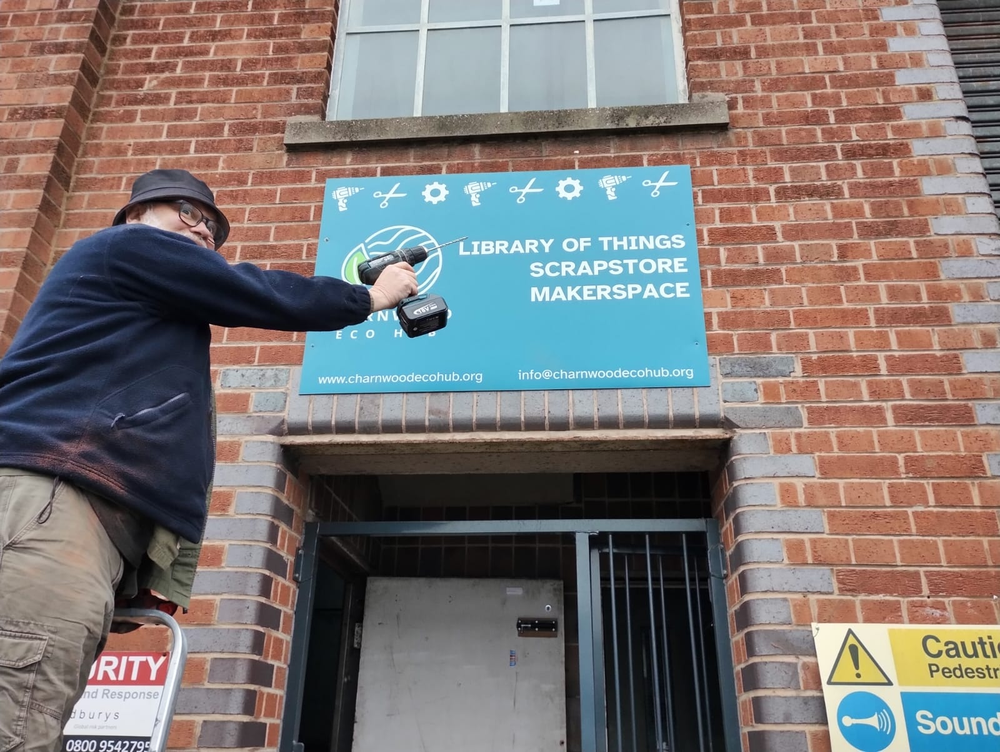

# Be Part of Bringing Our Makerspace to Life

{:width="75%"}

We’re excited to announce that our new **makerspace** is coming together — a place where creativity, craftsmanship, and community meet. To make it happen, we’re looking for skilled and enthusiastic people who can help us set things up and get everything running smoothly.

If you’ve got experience in woodworking, metalworking, electronics, workshop setup, or just a knack for problem-solving, we’d love to hear from you!

**Here’s what we already have in the workshop:**

- Laser Cutter
- Vacuum Former
- Industrial Sewing Machine & Overlocker
- Vinyl cutter
- Pillar Drill
- Lathe
- CNC Router
- Table Saw
- 3D printers
- Electric planer
- A growing set of hand tools

**And here’s what’s on the way:**

- Bench saw
- Band Saw
- Belt Sander
- Knitting machine
- Soldering Stations
- More specialist tools and equipment as we expand

We’re building more than just a workshop — we’re building a community resource. By volunteering your time and skills now, you’ll be helping lay the foundations for a space where people can learn, share, and make amazing things together.

👉 Interested? Drop us a message at [info@charnwoodecohub.org](mailto:info@charnwoodecohub.org).

Let’s create something incredible — together.

