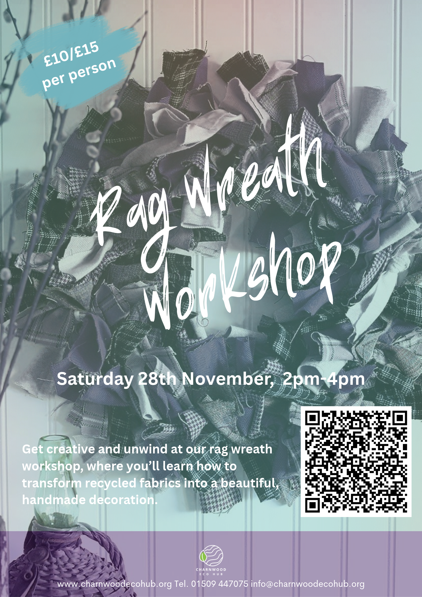

# Charnwood Eco Hub Rag Wreath Workshop

Sat 28th November, 2pm-4pm. £15/£10 per person

*Join us at Charnwood Eco Hub for a creative and sustainable rag wreath
workshop!*

Using colourful fabric scraps and reclaimed textiles, you'll create your own
beautiful, unique wreath to decorate your home. It's a lovely opportunity to
get creative, learn a simple upcycling technique and give unwanted materials a
new lease of life. No previous crafting experience is needed, and all materials
will be provided. Come along, enjoy a relaxed and friendly atmosphere, and
leave with a handmade decoration to be proud of!

You can book your place by scanning the QR code on the poster or [click
here](https://www.eventbookings.com/b/event/rag-wreath-workshop-6afca41ae12521-94524540). The
workshop costs £10 per person for students, retired, low income or Eco Hub
members, £15 per person standard price.

