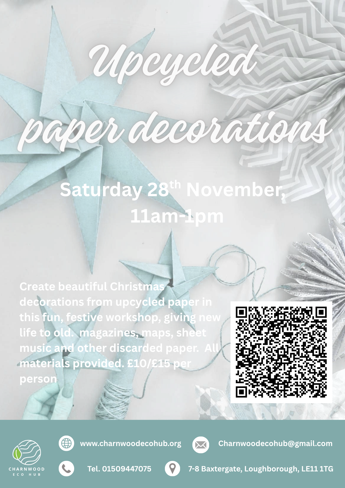

# Charnwood Eco Hub Upcycled Paper Christmas Decorations

Sat 28th November, 11am-1pm. £15/£10 per person

*Get creative at Charnwood Eco Hub with our upcycled paper decorations workshop!*

Discover how to transform unwanted paper, old books, magazines and other
reclaimed materials into beautiful handmade decorations. From delicate folded
designs to quirky decorative creations, you'll learn how to give everyday
materials a new lease of life while making something unique to take home. No
previous crafting experience is needed, and all materials will be provided. A
fun, relaxed and sustainable way to get creative!

You can book your place by scanning the QR code on the poster or [click 
here](https://www.eventbookings.com/b/event/upcycled-paper-christmas-decorations-6af9e105391700-11044181).
The workshop costs £10 per person for students, retired, low income or Eco Hub
members, £15 per person standard price.

